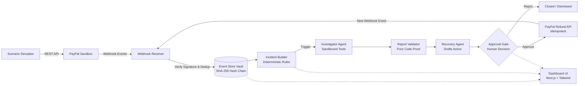

# TraceGuard 🛡️
> **Flight recorder for PayPal payments: tamper-evident evidence trail, deterministic detection, and human-in-the-loop recovery.**

Built for the **PayPal AI Hackathon (Devpost)**.

---

## 1. The Problem & Solution
When payment anomalies occur (duplicate charges, mismatched refunds, or customer chargebacks), financial teams struggle to piece together what happened across asynchronous webhooks, lost logs, and customer messages. 

**TraceGuard solves this as an automated flight recorder:**
- **Reconstructs** the incident timeline directly from real PayPal Sandbox webhook events.
- **Proves** event provenance with an immutable, SHA-256 tamper-evident hash chain.
- **Investigates** using an LLM agent with grounded tools and a strict code validator that rejects fabricated claims.
- **Remediates** with human-in-the-loop approval: the AI only drafts the recovery action; money never moves until a human clicks Approve with strict idempotency keys (`PayPal-Request-Id`).

---

## 2. Architecture Pipeline



---

## 3. Getting PayPal Sandbox Credentials

> [!IMPORTANT]
> **Strict Sandbox-Only Policy**: TraceGuard enforces `PAYPAL_BASE_URL=https://api-m.sandbox.paypal.com`. It will strictly refuse to start if a production PayPal domain is detected.

Follow these steps to obtain your credentials:

1. **Create a Developer Account**:
   - Go to [developer.paypal.com](https://developer.paypal.com) and sign in.
2. **Set up Sandbox Accounts**:
   - Navigate to **Testing Tools** > **Sandbox Accounts**.
   - Create one **Business account** (represents the merchant) and one **Personal account** (represents the customer).
3. **Create Sandbox REST App**:
   - Go to **Apps & Credentials** > **Sandbox** tab.
   - Click **Create App**, select your Business sandbox account, and create the app.
   - Copy the **Client ID** (`PAYPAL_CLIENT_ID`) and **Secret** (`PAYPAL_CLIENT_SECRET`).
4. **Register Webhook**:
   - Start your local tunnel (see Local Webhook Testing below) to get a public HTTPS URL (e.g., `https://abc-xyz.ngrok-free.app`).
   - In your sandbox app settings in the PayPal Developer Dashboard, scroll to **Webhooks** and click **Add Webhook**.
   - Webhook URL: `https://<YOUR-PUBLIC-BASE-URL>/webhooks/paypal`
   - Event types to subscribe to:
     - `Payment capture completed` (`PAYMENT.CAPTURE.COMPLETED`)
     - `Payment capture refunded` (`PAYMENT.CAPTURE.REFUNDED`)
     - `Customer dispute created` (`CUSTOMER.DISPUTE.CREATED`)
     - `Customer dispute resolved` (`CUSTOMER.DISPUTE.RESOLVED`)
   - Save and copy the generated **Webhook ID** (`PAYPAL_WEBHOOK_ID`).

> [!CAUTION]
> **Secret Hygiene & Revocation Notice**:
> Never commit `.env` or any secrets to GitHub.
> If a secret is ever pushed to GitHub, revoke and regenerate it immediately in the PayPal developer dashboard. Deleting or scrubbing the commit from git history is **not enough** because public commits are scraped within seconds.

---

## 4. Local Webhook Testing (Tunnel Setup)

PayPal Sandbox needs a publicly reachable HTTPS endpoint to deliver webhooks to your local machine.

### Option A: ngrok
```bash
# Install ngrok if not already installed
brew install ngrok

# Expose local FastAPI backend (port 8000)
ngrok http 8000
```
Copy the Forwarding URL (e.g., `https://abc-xyz.ngrok-free.app`) and set it as `PUBLIC_BASE_URL` in your `.env`.

### Option B: Cloudflare Tunnel (cloudflared)
```bash
# Install cloudflared
brew install cloudflared

# Run temporary tunnel to port 8000
cloudflared tunnel --url http://localhost:8000
```
Copy the generated `trycloudflare.com` URL into `PUBLIC_BASE_URL` in your `.env`.

---

## 5. Quickstart & Development

### Using Docker Compose (Full Stack)
```bash
# 1. Copy environment template
cp .env.example .env

# 2. Fill in your credentials in .env

# 3. Start all services (PostgreSQL, Backend API, Frontend Web)
docker compose up --build
```
- Frontend UI: [http://localhost:3000](http://localhost:3000)
- Backend API Docs: [http://localhost:8000/docs](http://localhost:8000/docs)
- Health Check: [http://localhost:8000/health](http://localhost:8000/health)

### Running Locally without Docker

#### Backend
```bash
# Create and activate virtual environment
python3 -m venv .venv
source .venv/bin/activate

# Install dependencies
pip install -r backend/requirements.txt

# Run migrations
alembic upgrade head

# Run tests & lint
ruff check .
pytest -v

# Start development server
uvicorn backend.app.main:app --reload --port 8000
```

#### Frontend
```bash
cd frontend
npm install
npm run dev
```

---

## 6. Target Hosting & Deployment Notes
- **Backend API**: Render or Railway (Python 3.11 environment with background worker support).
- **Database**: Neon (Serverless Postgres) or Supabase.
- **Frontend**: Vercel (Next.js App Router).

> [!NOTE]
> **Demo Check Warning**: Free tiers on Render/Railway and Neon sleep on idle (cold boot ~30-50s). Before presenting or recording a live demo, trigger a warm-up request to `GET /health` to ensure zero-latency responsiveness.
