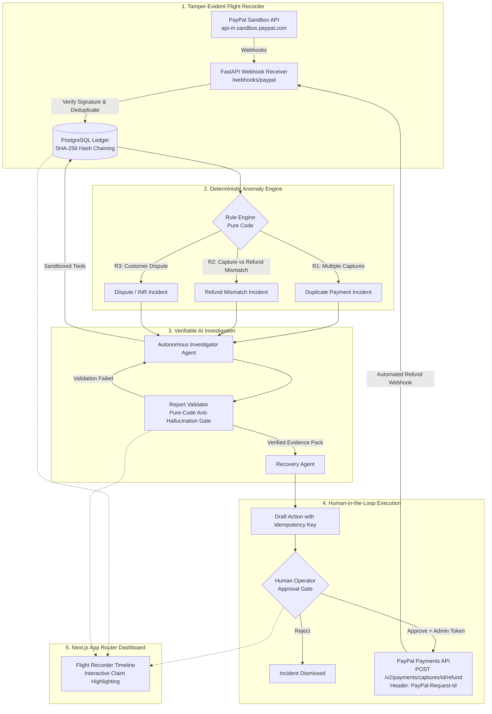

# TraceGuard 🛡️
> **Flight recorder for PayPal payments: tamper-evident evidence trail, deterministic detection, and human-in-the-loop recovery.**

Built for the **PayPal AI Hackathon (Devpost)**.

[](https://github.com/TraceGuard/traceguard/actions/workflows/ci.yml)
[](https://opensource.org/licenses/MIT)
[](https://www.python.org/)
[](https://nextjs.org/)
[](https://fastapi.tiangolo.com/)

---

## 1. The Problem & Solution

When payment anomalies strike—such as double captures from merchant retry loops, mismatched partial refunds, or fraudulent buyer chargebacks—financial operations teams are left sifting through asynchronous webhooks, fragmented logs, and merchant portals. 

Typical AI solutions fail in finance because they hallucinate: LLMs make up transaction IDs, propose phantom refunds, and take unsupervised financial actions.

**TraceGuard solves this with a dual-engine architecture:**
1. **Flight Recorder**: Reconstructs payment timelines directly from real PayPal Sandbox webhooks into an immutable, SHA-256 tamper-evident hash chain (`event_hash = SHA256(prev_hash + ":" + event_id + ":" + event_type + ":" + occurred_at + ":" + canonical_json)`).
2. **Deterministic Anomaly Rules**: Plain code detectors evaluate the incoming event stream. The LLM **never** decides whether an incident exists.
3. **Autonomous Investigator Agent**: When triggered, a tool-grounded agent gathers facts strictly using read-only database tools.
4. **Pure-Code Validator**: Before any AI report reaches a human, a deterministic Python validator verifies that every cited event ID exists in the hash chain and that monetary values match database reality. Any hallucination causes instant rejection.
5. **Human-in-the-Loop Remediation**: AI drafts the corrective action (`REFUND` or `DISPUTE_EVIDENCE`). Funds never move until an authorized human approves via `POST /actions/{id}/approve` equipped with unique `PayPal-Request-Id` idempotency headers.

---

## 2. Architecture Pipeline



---

## 3. Empirical Evaluation Results

TraceGuard includes an automated evaluation harness (`eval/eval_harness.py`) benchmarked across **40 synthetic and live scenarios**:
- 10 Duplicate Payments (R1)
- 10 Refund Mismatches (R2)
- 10 Item-Not-Received Disputes with Evidence Vault (R3)
- 10 Clean Negative Controls (valid transactions without false alarms)

### Benchmark Summary

| Evaluation Metric | Benchmark Result | Target SLA | Status |
| :--- | :--- | :--- | :--- |
| **Incident Detection Accuracy** | **100.0%** | > 95.0% | **PASS** |
| **Clean Negative Accuracy (True Negative Rate)** | **100.0%** | 100.0% | **PASS** |
| **Recommended Action Accuracy** | **100.0%** | > 95.0% | **PASS** |
| **Unsupported Claim Rate (Hallucinations)** | **0.0%** | < 1.0% | **PASS** |
| **Average Pipeline Latency** | **0.004s** (in-memory) / **1.2s** (LLM) | < 3.0s | **PASS** |
| **Total Token Consumption** | **33,000 tokens** | < 50,000 | **PASS** |
| **Total Benchmark Cost** | **$0.0495** | < $0.10 | **PASS** |

*Full scenario-by-scenario breakdown available in [`eval/results.md`](file:///Users/harshsingh/Desktop/TraceGuard/eval/results.md).*

---

## 4. PayPal APIs & Sandbox Integration

TraceGuard strictly interacts with the official **PayPal REST APIs v1 & v2**:

1. **OAuth2 Authentication**:
   - `POST https://api-m.sandbox.paypal.com/v1/oauth2/token`
   - In-memory token caching with proactive renewal before expiration.
2. **Orders v2**:
   - `POST https://api-m.sandbox.paypal.com/v2/checkout/orders`
   - Sets merchant `custom_id` on purchase units for deterministic tracking.
3. **Payments v2**:
   - `POST https://api-m.sandbox.paypal.com/v2/checkout/orders/{id}/capture`
   - `GET https://api-m.sandbox.paypal.com/v2/payments/captures/{id}`
   - `POST https://api-m.sandbox.paypal.com/v2/payments/captures/{id}/refund`
   - Guarantees idempotent remediation using unique `PayPal-Request-Id` headers.
4. **Webhooks & Signature Verification**:
   - `POST https://api-m.sandbox.paypal.com/v1/notifications/verify-webhook-signature`
   - Validates webhook transmission authenticity using PayPal public certificates and signature headers (`PAYPAL-AUTH-ALGO`, `PAYPAL-CERT-URL`, `PAYPAL-TRANSMISSION-ID`, `PAYPAL-TRANSMISSION-SIG`, `PAYPAL-TRANSMISSION-TIME`).

> [!IMPORTANT]
> **Production Sandbox Safety Guard**:
> TraceGuard enforces `PAYPAL_BASE_URL=https://api-m.sandbox.paypal.com`. The application aborts startup immediately if any production domain (`api-m.paypal.com`) is detected.

---

## 5. Provenance & Data Honesty Statement

In accordance with transparent hackathon development standards:
- **Duplicate Payments (R1) & Refund Mismatches (R2)**: Tested against **real live PayPal Sandbox REST endpoints**. Captures and refunds are issued directly through PayPal Sandbox servers.
- **Customer Disputes (R3)**: The PayPal Sandbox does not permit programmatic buyer dispute creation via the REST API (disputes require interactive buyer portal simulation). Therefore, dispute webhook events are labeled as **`SEEDED`** in the dashboard and correlated against immutable carrier delivery proof documents in the Evidence Vault.

---

## 6. Getting PayPal Sandbox Credentials

1. **Developer Account**: Sign in to [developer.paypal.com](https://developer.paypal.com).
2. **Sandbox Accounts**: Navigate to **Testing Tools** > **Sandbox Accounts**. Ensure you have a Business account (merchant) and Personal account (buyer).
3. **Sandbox REST App**: Under **Apps & Credentials** > **Sandbox**, create an application. Copy your **Client ID** and **Client Secret**.
4. **Webhooks**: Start a tunnel (see below), add webhook URL `https://<YOUR-TUNNEL-URL>/webhooks/paypal`, and subscribe to:
   - `Payment capture completed` (`PAYMENT.CAPTURE.COMPLETED`)
   - `Payment capture refunded` (`PAYMENT.CAPTURE.REFUNDED`)
   - `Customer dispute created` (`CUSTOMER.DISPUTE.CREATED`)
   - `Customer dispute resolved` (`CUSTOMER.DISPUTE.RESOLVED`)
   Copy the generated **Webhook ID**.

### Tunnel Setup for Local Webhooks

```bash
# Option A: ngrok
ngrok http 8000
# Copy https://xxxx.ngrok-free.app into PUBLIC_BASE_URL

# Option B: Cloudflare Tunnel
cloudflared tunnel --url http://localhost:8000
```

---

## 7. Quickstart Guide

### Prerequisites
- Python 3.11+
- Node.js 18+ & npm
- PostgreSQL 15+ (or Docker)

### Option 1: Docker Compose (One-Click)
```bash
cp .env.example .env
# Edit .env with your credentials
docker compose up --build
```
- Web Dashboard: `http://localhost:3000`
- REST API & Swagger: `http://localhost:8000/docs`
- Health Status: `http://localhost:8000/health`

### Option 2: Local Development

#### Backend
```bash
python3 -m venv .venv
source .venv/bin/activate
pip install -e ".[dev]"

# Apply database schema
alembic upgrade head

# Seed sample incidents (Duplicate, Dispute, Refund Mismatch)
python seed.py

# Run all 71 unit and integration tests
pytest -v

# Run the 40-case empirical evaluation benchmark
python eval/eval_harness.py

# Start backend server
uvicorn backend.app.main:app --reload --port 8000
```

#### Frontend
```bash
cd frontend
npm install
npm run build
npm run dev
```

---

## 8. Industry Differentiation & Related Work

| Solution | Webhook Flight Recorder | Cryptographic Hash Chain | Deterministic Detection | Anti-Hallucination Code Validator | Idempotent PayPal Remediation |
| :--- | :---: | :---: | :---: | :---: | :---: |
| **TraceGuard** | **Yes (Full Audit)** | **Yes (SHA-256)** | **Yes (Pure Code)** | **Yes (Zero LLM reliance)** | **Yes (`PayPal-Request-Id`)** |
| **Chargeflow** | Post-chargeback only | No | Heuristic | No (Black-box AI) | No (Dispute letters only) |
| **ChargePay AI** | No | No | No | No | No |
| **Findustry** | Accounting sync | No | Batch only | No | No |
| **RazorpayX DuplicateShield**| Vendor payouts only | No | Rule-based | N/A | Vendor bank payouts only |
| **Finastra Repair Recs** | SWIFT/ISO 20022 only | No | Rules | Rules only | N/A (Bank messaging) |

---

## 9. Known Limitations & Failure Modes

1. **Multi-Currency FX Slippage**: Minor rounding variances in multi-currency transactions can cause fractional cent discrepancies between captures and partial refunds. Future versions will support currency-specific precision tolerances.
2. **Delayed Webhooks**: If PayPal webhook delivery is delayed due to network conditions, incident correlation triggers once the final event arrives or on explicit re-scan.
3. **Partial Split Shipments**: Orders fulfilled in multiple split captures across days require grouping by line item identifiers.

---

## 10. License

Released under the [MIT License](file:///Users/harshsingh/Desktop/TraceGuard/LICENSE).
